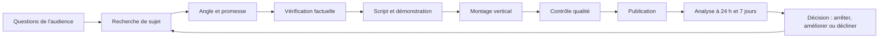

# HashCode TikTok — stratégie éditoriale et croissance

> Référentiel de travail pour construire une présence TikTok utile, cohérente et mesurable pour HashCode.
>
> **Statut :** documentation initiale — à valider avec les données du compte TikTok.  
> **Dernière revue documentaire :** 12 octobre 2026.  
> **Langue éditoriale principale :** français, avec attention au public béninois et francophone.

## Objectif

Faire de TikTok un canal de découverte et de confiance pour HashCode grâce à des contenus de technologie concrets : développement web, cybersécurité défensive, OSINT responsable, IA appliquée, apprentissage technique et coulisses de construction.

La stratégie ne promet pas la viralité. Elle met en place une boucle d'apprentissage : **rechercher → produire → publier → mesurer → améliorer**.

## Décisions éditoriales

1. Priorité à la valeur démontrée : tutoriels, preuves à l'écran, explications, cas pratiques et retours d'expérience.
2. Les contenus de marque et les affiches soutiennent la notoriété, mais ne remplacent pas les vidéos éducatives.
3. Ne jamais présenter une fonctionnalité, un site, une formation ou une inscription comme disponible tant que ce n'est pas confirmé.
4. En cybersécurité et OSINT, utiliser des environnements autorisés, des exemples fictifs/anonymisés et des démonstrations non nuisibles.
5. Utiliser l'IA comme outil de production, pas comme substitut à la vérification, au jugement éditorial ou à l'originalité.
6. Les durées, horaires, fréquences, hashtags et formats sont des **hypothèses à tester**, pas des règles de l'algorithme.
7. Ne pas acheter d'engagement et ne pas promettre de résultats de croissance.

## Documents

- [01 — Stratégie et positionnement](docs/01-strategie-positionnement.md)
- [02 — Tendances et fonctionnement de TikTok](docs/02-tendances-et-algorithme.md)
- [03 — Piliers éditoriaux et formats](docs/03-piliers-et-formats.md)
- [04 — Workflow de production assisté par IA](docs/04-workflow-production.md)
- [05 — Calendrier éditorial de 30 jours](docs/05-calendrier-editorial-30-jours.md)
- [06 — Mesure, expérimentation et tableau de bord](docs/06-mesure-et-experimentation.md)
- [07 — Sécurité, conformité et qualité](docs/07-securite-conformite.md)
- [08 — Schémas de processus](docs/08-schemas-processus.md)
- [09 — Brief de campagne : sept affiches](docs/09-campagne-sept-affiches.md)
- [10 — Sources et veille](docs/10-sources-et-veille.md)

## Boucle de fonctionnement

## Liens externes

- [TikTok Next 2026 — rapport de tendances](https://ads.tiktok.com/business/en-US/next)
- [TikTok Newsroom — présentation TikTok Next 2026](https://newsroom.tiktok.com/introducing-tiktok-next-2026-our-trend-forecast-for-marketers-for-the-year-ahead?lang=en)
- [Comment TikTok recommande le contenu](https://support.tiktok.com/en/using-tiktok/exploring-videos/how-tiktok-recommends-content)
- [Creator Search Insights](https://support.tiktok.com/en/using-tiktok/growing-your-audience/creator-search-insights)
- [TikTok Studio](https://support.tiktok.com/en/using-tiktok/creating-videos/tiktok-studio)
- [Contenus générés par l'IA](https://support.tiktok.com/fr/using-tiktok/creating-videos/ai-generated-content)
- [Consignes communautaires](https://www.tiktok.com/community-guidelines)

## Comment utiliser ce dépôt

Chaque semaine :
1. choisir les sujets d'après les questions de l'audience et les recherches observables ;
2. publier un ensemble équilibré de formats ;
3. enregistrer les indicateurs disponibles dans TikTok Studio ;
4. examiner les résultats à durée comparable et par objectif ;
5. conserver les apprentissages dans le journal d'expérimentation ;
6. mettre à jour le calendrier, sans supposer qu'un seul succès garantit un résultat futur.
