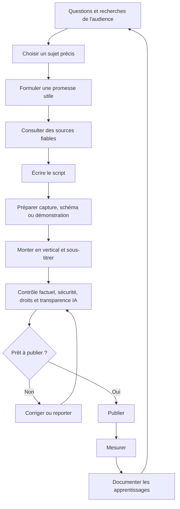

# 04 — Workflow de production assisté par IA

## Objectif

Produire des contenus réguliers sans sacrifier la vérification technique, l'originalité et la sécurité. L'IA sert à accélérer la préparation ; une personne reste responsable de la vérité, du cadrage et de la publication.

## Processus

## Étapes détaillées

### 1. Recherche
- Trouver une question provenant des commentaires, de la communauté, de Creator Search Insights ou d'une observation pertinente.
- Lire une documentation officielle ou une source primaire pour les faits techniques.
- Vérifier la version des outils et la date de l'information.
- Noter ce qui est confirmé, incertain et spécifique au contexte.

### 2. Brief éditorial
Pour chaque idée, renseigner :
- public visé ;
- question à résoudre ;
- une seule promesse ;
- preuve ou démonstration ;
- risques d'interprétation ;
- CTA ;
- indicateur principal de réussite.

### 3. Écriture
Demander à l'IA plusieurs accroches, puis choisir celle qui décrit fidèlement la vidéo. Un bon script ne fait pas de promesse plus forte que sa démonstration.

### 4. Production
- Capture d'écran de son propre environnement ou d'un environnement autorisé.
- Utiliser des données fictives/anonymisées.
- Afficher le résultat et le chemin qui y mène.
- Éviter les écrans chargés, clés API, tokens, adresses privées, e-mails, noms d'utilisateurs et identifiants.
- Garder des fichiers sources et des notes de provenance.

### 5. Montage
- Format vertical et bonne résolution.
- Éviter les silences et écrans vides non nécessaires.
- Sous-titres révisés manuellement pour les noms d'outils, commandes et termes anglais.
- Musique et effets seulement s'ils améliorent le contenu et sont autorisés.
- Ne pas fabriquer un faux témoignage, un faux écran produit ou une fausse démonstration.

### 6. Revue avant publication
Vérifier l'exactitude, les permissions, les données visibles, l'accessibilité, l'accroche, les sous-titres, le CTA et les éventuelles mentions d'IA.

### 7. Mesure
Saisir les statistiques réellement accessibles à 24 heures et à 7 jours. Éviter de conclure sur un seul indicateur ou une seule vidéo.

## Prompt de travail réutilisable

> Agis comme un éditeur pédagogique et un vérificateur technique pour HashCode. Propose un script vertical en français pour [PUBLIC] qui répond à [QUESTION]. La promesse doit être précise et démontrable. Structure : accroche, contexte en une phrase, démonstration étape par étape, conclusion, CTA unique. Fournis aussi le texte à l'écran, les sous-titres suggérés, la description, trois à cinq hashtags pertinents maximum comme hypothèse éditoriale, les sources primaires à consulter et une checklist de sécurité. Distingue faits vérifiés, hypothèses et éléments à tester. N'invente aucun chiffre, résultat, témoignage ou fonctionnalité. Si le sujet concerne la cybersécurité ou l'OSINT, garde la démonstration dans un environnement autorisé et protège les données personnelles.

## Utilisation de l'IA générative

TikTok exige une mention pour certains contenus générés ou substantiellement modifiés par l'IA, en particulier lorsqu'ils contiennent des images, des sons ou des vidéos réalistes. Consulter la politique officielle à jour avant publication : https://support.tiktok.com/fr/using-tiktok/creating-videos/ai-generated-content

Ne pas ajouter une mention au hasard ni croire qu'une mention autorise un contenu interdit. Appliquer les règles à la création réellement publiée.
