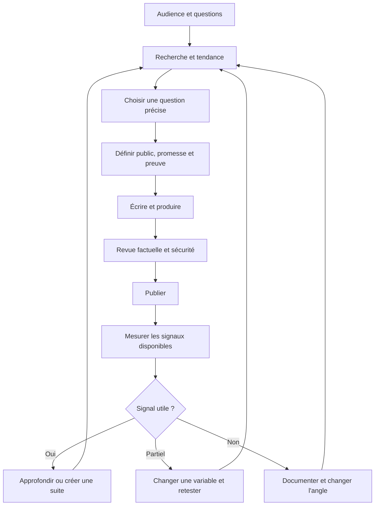
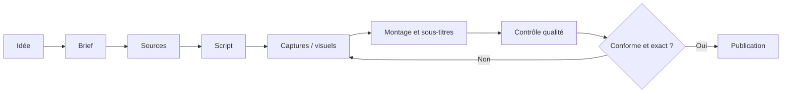
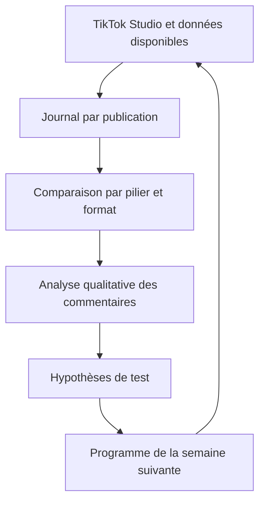
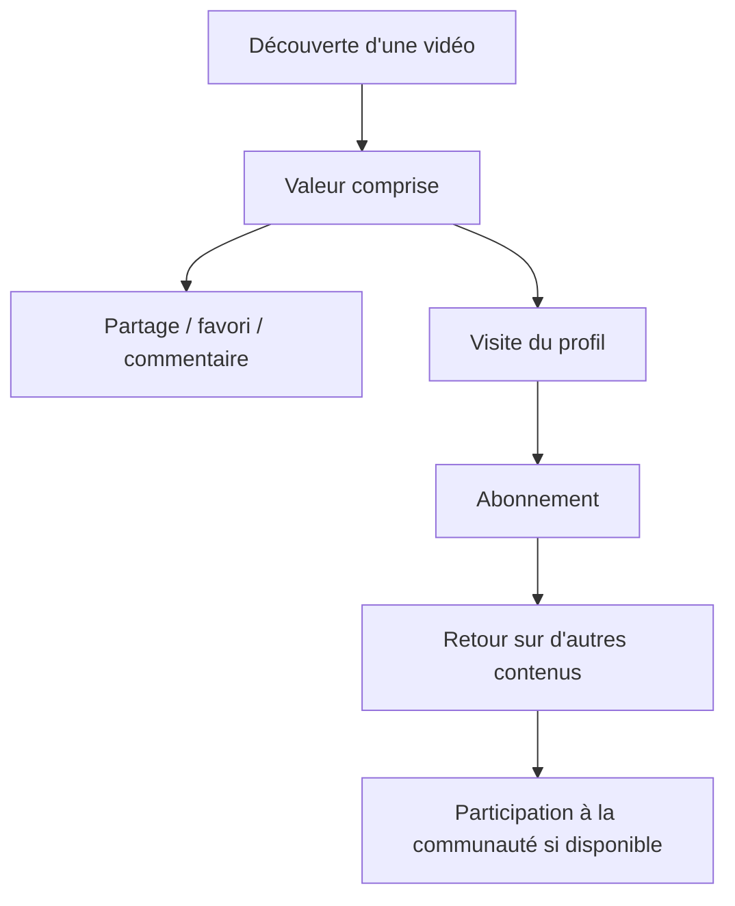

# 08 — Schémas de processus

Les schémas sont écrits en Mermaid pour être prévisualisables sur GitHub.

## 1. La stratégie de contenu

## 2. Le parcours d'une idée vers une publication

## 3. Architecture de mesure

## 4. Funnel organique réaliste

Ce funnel est un modèle éditorial pour comprendre les étapes possibles. Il ne représente ni les événements garantis pour chaque spectateur ni les pondérations de l'algorithme.
